# WatchPlay

手机 → 手表投屏协议与参考实现。

手机 App 用 HTML + CSS 渲染手表界面，经 WebView 捕获后编码为 MJPEG/H.264，通过 BLE 发送到手表显示；手表触控回传手机。不使用 MediaProjection 录屏，不涉及屏幕录制权限。

[协议规范](docs/spec/00-overview.md) · [快速开始](docs/guides/getting-started.md) · [贡献指南](CONTRIBUTING.md)

https://github.com/user-attachments/assets/4c5a509c-e545-4814-9243-6bca52fac498

53 秒，1920×1080，带背景音 · 画面不是录屏：它由 [docs/video/index.html](docs/video/index.html) 按时间轴逐帧渲染再编码，片中每一帧手表画面都是 `examples/watch-ui` 里那份 HTML 的真实渲染。

---

## 与传统投屏的区别

| | MediaProjection 投屏 | WatchPlay |
| :--- | :--- | :--- |
| 画面来源 | 整块手机屏幕，缩放到手表 | App 自行渲染的手表 UI |
| 权限 | 录屏授权弹窗 | 无 |
| 分辨率 | 手机原生，需缩放 | 按手表分辨率渲染 |
| 交互 | 单向 | 触控回传 |

## 架构



音频不在数据通道里：本协议只传画面与触控。带 A2DP 的设备可以让音频走独立链路，其余设备由手机本地播放。

## 编码 Profile

| Profile | 适用芯片 | 编码 | 带宽 | 手表端解码 |
| :--- | :--- | :--- | :--- | :--- |
| **A: MJPEG** | 低端 MCU（ESP32-S3） | 手机端压 JPEG | 150–300 KB/s @ 10 fps | JPEG 硬解，10–15 fps |
| **B: H.264** | 中高端（带硬解） | MediaCodec Baseline | 200–800 kbps | 硬解，15–30 fps |

A 是基线，B 是省带宽的可选项。哪一档由协商按硬件能力决定：软解 H.264 的芯片（如 ESP32-S3）上报 `hardware_decode = 0`，自动退回 A。参数细节见 [04-video.md](docs/spec/04-video.md)。

## 承载

| 承载 | 适用设备 | 状态 |
| :--- | :--- | :--- |
| BLE GATT | 基线，任何支持 BLE 的设备 | 已实现（SDK + `android/sink`），未真机联调 |
| BLE L2CAP CoC | 手机 Android 10+，开销低于 GATT | SDK 骨架，`open()` 未接通 |
| 经典蓝牙 RFCOMM (SPP) | 只有 BR/EDR、没有可用 BLE 的设备 | 规范已定，未实现 |
| Wi-Fi TCP | 需要高码率的场景 | 已实现（SDK `WifiTcpTransport`，本机回环测试）；发现与交接未实现 |

## 仓库结构

```
docs/
  spec/                    协议规范（权威）
    00-overview.md           总览与设计目标
    01-transport.md          承载：BLE GATT / L2CAP CoC / 经典蓝牙 SPP / Wi-Fi
    02-wire-format.md        16 字节帧头、CRC、帧类型
    03-session.md            握手、能力协商、状态机、心跳
    04-video.md              分块、Credit 流控、丢帧恢复
    05-input.md              触控回传与坐标映射
    06-rendering.md          圆屏/方屏安全区与 CSS 契约
    07-capabilities.md       能力位、TLV 注册表、版本兼容
    99-changelog.md          协议变更记录
  diagrams/                文档插图（Mermaid 源 + 渲染好的 SVG）
  guides/                  使用指南
android/
  sdk/                     手机端 Kotlin SDK（com.watchplay.sdk）
  demo/                    示例 App：渲染示例场景 + loopback 演示 + BLE 扫描连接
  sink/                    手表端参考 App：GATT server、JPEG 解码、触控回传
watch/                     手表端参考架构（文档；示例硬件 ESP32-S3）
tools/                    协议参考实现与校验工具（仅标准库）
examples/
  watch-ui/                示例手表 UI（HTML+CSS）
  protocol-traces/         字节级 trace（由 tools/gen_traces.py 生成）
```

## 快速开始

无需硬件，用 Python 校验协议实现：

```pwsh
git clone https://github.com/newMalloc/WatchPlay
cd WatchPlay
python tools/test_protocol.py        # 49 项一致性测试
python tools/gen_traces.py --check   # trace 与规范一致
python tools/lint_scenes.py          # 示例场景符合渲染规范
python tools/check_doc_links.py      # 文档交叉引用与锚点
```

Android 与手表端构建见 [快速开始指南](docs/guides/getting-started.md)，其中有一节讲怎么用两台 Android 设备跑通真实链路。

## 路线图

| 阶段 | 目标 |
| :--- | :--- |
| 第一阶段 | 协议 v0.1，MJPEG 端到端 Demo，466×466 @ 10 fps，延迟 < 200 ms |
| 第二阶段 | 地图导航 + 音乐播放，经典蓝牙承载，H.264 支持，Wi-Fi 通道 |
| 第三阶段 | Android SDK 发布，协议 v1.0，兼容性测试套件，iOS 启动 |
| 第四阶段 | 厂商接入，WatchPlay Certified 认证 |

| 里程碑 | 交付物 | 状态 |
| :--- | :--- | :--- |
| M1 | MJPEG 投屏 Demo | 手机端 SDK 与手表端 App 已实现（163 项 JVM 测试）；已在真机跑通 loopback：466×466 MJPEG @6–8 fps、`latency` 5–13 ms，Demo 内可看到即将发出的那一帧，画面与缩略图都按屏幕形状裁切（圆屏裁成圆形、方屏按上报的安全区取圆角半径）。BLE 双机未联调 |
| M2 | 地图导航 + 音乐播放 | 场景三页已能互切；时间、电量、导航转向由手机每秒推送；音乐播的是手机自己的曲库（`MediaStore` + `MediaPlayer`），封面取曲目的内嵌图、以 96×96 `data:` URI 推给场景，手表上的播控回传生效。导航仍是脚本路线而非路径规划 |
| M3 | H.264 + Wi-Fi 通道 | Wi-Fi 与经典蓝牙承载：规范已定，无实现；H.264：编码器是桩，且无硬解参考硬件 |
| M4 | Android SDK | 可构建（67 项 JVM 测试），未发布 |
| M5 | 协议 v1.0 + 认证计划 | 未开始 |
| M6 | 首个厂商接入 | 未开始 |

## 参考硬件

以下只是**一块**能跑通参考实现的板子，协议不依赖它的任何特性：换芯片、换屏、换承载都不需要改协议。

| 端 | 硬件 |
| :--- | :--- |
| 手表 | LilyGO T-Display S3 AMOLED 1.43 — ESP32-S3R8, 8 MB PSRAM, 466×466 圆屏, FT3168 触摸 |
| 手机 | 任意 Android 8.0+（`minSdk 26`） |

## 参与

问题与 bug 请开 [Issue](https://github.com/newMalloc/WatchPlay/issues)。提交 PR 前请先读[贡献指南](CONTRIBUTING.md)。

## 许可证

[Apache License 2.0](LICENSE)
