# 03 — 会话（Session）

本文件定义 WatchPlay v0.1 的连接建立、能力协商、状态机、心跳与错误处理。字节布局遵循 [02-wire-format.md](02-wire-format.md) 的 16 字节帧头约定。

## 1. 状态机



任一状态收到 `BYE`、帧结构错误或超时，都回到 `IDLE`（见 [§7](#7-bye-断开)）。

### 1.1 状态定义

| 状态 | 含义 | 允许发送的帧 | 超时 |
| :--- | :--- | :--- | :--- |
| `IDLE` | 未连接 | 无 | — |
| `CONNECTING` | 传输层正在建链（GATT 连接 / L2CAP CoC / TCP） | 无 | 10 s |
| `HANDSHAKING` | 已建链，交换 `HELLO` / `HELLO_ACK` | `HELLO`, `HELLO_ACK`, `BYE` | 3 s |
| `NEGOTIATING` | 交换 `CAPS` / `CAPS_ACK` | 上述 + `CAPS`, `CAPS_ACK` | 3 s |
| `STREAMING` | 正常传输视频与触控 | 全部 | — |
| `DRAINING` | 暂停推流，但链路上仍有未确认数据在收尾 | 全部（`VIDEO` 除外） | 2 s |
| `FAILED` | 会话出错，等待重连或用户干预 | `BYE` | — |

> **注意**：`DRAINING` 不是一个"优雅关闭"状态，而是**背压状态**。当接收端的解码队列满、或 Credit 耗尽超过 `drain_timeout` 时，发送端进入 `DRAINING`，停止发送 `VIDEO`，但保持心跳与 `FEEDBACK` 往返，等待接收端恢复后回到 `STREAMING`。

### 1.2 发起方向

**接收端（手表）是连接发起方。** 理由：

- 手表的 BLE 广播是低功耗的被动行为，由它发起连接更符合 BLE 外设的角色模型。
- 手机可能同时面对多块手表，由手表主动声明身份更易管理。
- 手机侧作为 GATT Central 可以随时主动断开，纠正异常。

因此 `HELLO` 恒由手表发出、`HELLO_ACK` 恒由手机回复。`CAPS` 恒由手表发出。

## 2. 握手：`HELLO` / `HELLO_ACK`

### 2.1 `HELLO`（手表 → 手机，定长 52 字节）

| 偏移 | 长度 | 字段 | 类型 | 说明 |
| :--- | :--- | :--- | :--- | :--- |
| 0 | 1 | `proto_version` | u8 | 协议版本，v0.1 = `1`。**冗余**于帧头的 `version`，便于负载自描述 |
| 1 | 1 | `min_version` | u8 | 本设备能接受的最低版本 |
| 2 | 2 | `flags` | u16 | 通用能力位，见 [§2.3](#23-hello-flags) |
| 4 | 4 | `nonce` | u32 | 本次启动的随机数，用于 `HELLO_ACK` 配对校验 |
| 8 | 16 | `device_id` | u8[16] | BLE MAC 或芯片唯一 ID，全 0 表示未提供 |
| 24 | 12 | `model` | char[12] | ASCII，如 `"T-Disp-S3"`，不足补 `\0` |
| 36 | 8 | `fw_version` | char[8] | ASCII，如 `"0.1.0"`，不足补 `\0` |
| 44 | 8 | `reserved` | u8[8] | **必须（MUST）** 为 0，接收方忽略 |

> 为什么 `proto_version` 在帧头和负载里各有一份：帧头的 `version` 用于**帧解析器**在做任何负载解析之前就判断兼容性（见 [02-wire-format.md §7](02-wire-format.md)），负载里的副本让抓包工具和日志在只看负载时也能自描述。两者 **必须（MUST）** 一致；不一致时以帧头为准并计入 `malformedFrames`。

### 2.2 `HELLO_ACK`（手机 → 手表，定长 24 字节）

| 偏移 | 长度 | 字段 | 类型 | 说明 |
| :--- | :--- | :--- | :--- | :--- |
| 0 | 1 | `proto_version` | u8 | 手机选定的协议版本 |
| 1 | 1 | `status` | u8 | 见 [§2.4](#24-hello_ack-状态码) |
| 2 | 2 | `flags` | u16 | 手机能力位，见 [§2.3](#23-hello-flags) |
| 4 | 4 | `peer_nonce` | u32 | **回显**手表 `HELLO.nonce` |
| 8 | 8 | `sdk_version` | char[8] | 如 `"0.1.0"` |
| 16 | 8 | `reserved` | u8[8] | 必须为 0 |

`peer_nonce` 的作用：手机可能因 BLE 重连而重复收到旧的 `HELLO`。手表收到 `peer_nonce` 与当前 `nonce` 不符的 `HELLO_ACK` 时 **必须（MUST）** 忽略它并重发 `HELLO`。

### 2.3 HELLO flags

| 位 | 掩码 | 名称 | 含义 |
| :--- | :--- | :--- | :--- |
| 0 | `0x0001` | `HAS_DISPLAY` | 有屏（纯音频设备清零） |
| 1 | `0x0002` | `HAS_TOUCH` | 有触控。清零时手机 **禁止（MUST NOT）** 期待 `TOUCH` 帧 |
| 2 | `0x0004` | `HAS_PSRAM` | 有外部 PSRAM（影响可接受的帧缓冲数） |
| 3 | `0x0008` | `SUPPORTS_L2CAP_COC` | 支持 L2CAP CoC 承载 |
| 4 | `0x0010` | `SUPPORTS_WIFI` | 支持 Wi-Fi 承载 |
| 5 | `0x0020` | `SUPPORTS_A2DP` | 支持经典蓝牙 A2DP。由设备能力决定；参考实现（ESP32-S3）无经典蓝牙，为 0 |
| 6 | `0x0040` | `IS_BATTERY_POWERED` | 电池供电，手机应更保守地推流 |
| 7–15 | — | *保留* | 必须为 0 |

### 2.4 HELLO_ACK 状态码

| 值 | 名称 | 含义 | 后续动作 |
| :--- | :--- | :--- | :--- |
| `0x00` | `OK` | 接受，进入 `NEGOTIATING` | 手机等待 `CAPS` |
| `0x01` | `UNSUPPORTED_VERSION` | 版本无法兼容 | 手表 **必须（MUST）** 断开，不得重试同一版本 |
| `0x02` | `BUSY` | 手机已连满（建议上限 4 块手表） | 手表 **应当（SHOULD）** 退避 5–30 s 后重试 |
| `0x03` | `REJECTED` | 策略拒绝（用户未授权/设备被拉黑） | 手表 **禁止（MUST NOT）** 自动重试 |

### 2.5 版本兼容规则

`HELLO.min_version` ≤ 手机支持的最高版本，且 `HELLO.proto_version` ≥ 手机支持的最低版本时，握手成功。手机选定的版本 **必须（MUST）** 是双方都支持的最高版本，且写入 `HELLO_ACK.proto_version`。

v0.1 实现只支持版本 `1`：

- 收到 `proto_version > 1` 且 `min_version ≤ 1`：**应当（SHOULD）** 按 v0.1 继续（向前兼容）。
- 收到 `min_version > 1`：**必须（MUST）** 回 `UNSUPPORTED_VERSION` 并断开。

## 3. 能力协商：`CAPS` / `CAPS_ACK`

### 3.1 `CAPS`（手表 → 手机）

`CAPS` 使用 **TLV 列表**（而非定长结构），因为屏幕、解码器、音频、输入各维度的能力会随硬件差异很大，定长结构会迅速耗尽 128 字节预算。

```
TLV 单元： type(u8) | len(u8) | value(len 字节)    ← 全部小端
```

| `type` | 名称 | 必需 | `len` | 说明 |
| :--- | :--- | :--- | :--- | :--- |
| `0x01` | `DEVICE_INFO` | **必须** | 16 | 见 §3.2 |
| `0x02` | `DISPLAY` | 有屏时**必须** | 16 | 见 §3.3 |
| `0x03` | `CODEC_MJPEG` | 二者至少一个 | 4 | 见 §3.4 |
| `0x04` | `CODEC_H264` | 二者至少一个 | 8 | 见 §3.5 |
| `0x05` | `INPUT` | 有触控时**应当** | 4 | 见 §3.6 |
| `0x06` | `AUDIO` | 可选 | 4 | 见 §3.7 |
| `0x07` | `MEMORY` | 可选 | 8 | PSRAM/堆大小，见 §3.8 |
| `0x08` | `POWER` | 可选 | 4 | 电池与热限制 |
| `0x80`–`0xFF` | *厂商私有* | 可选 | — | 接收方 **必须（MUST）** 跳过不认识的 TLV |

未知 `type` **必须（MUST）** 按 `len` 跳过，**禁止** 因此失败。`len` 比规范值大时 **应当（SHOULD）** 读取前 N 字节并跳过剩余；比规范值小时 **必须（MUST）** 忽略该 TLV（视为损坏）。

### 3.2 `DEVICE_INFO`（16 字节）

| 偏移 | 长度 | 字段 | 类型 | 说明 |
| :--- | :--- | :--- | :--- | :--- |
| 0 | 1 | `proto_version` | u8 | |
| 1 | 1 | `fw_major` | u8 | 固件主版本 |
| 2 | 1 | `fw_minor` | u8 | |
| 3 | 1 | `fw_patch` | u8 | |
| 4 | 8 | `chip_id` | u8[8] | 设备唯一 ID，小端；参考实现用 ESP32-S3 的 MAC |
| 12 | 4 | `build_id` | u32 | 固件构建号，用于匹配符号表 |

### 3.3 `DISPLAY`（16 字节）

| 偏移 | 长度 | 字段 | 类型 | 说明 |
| :--- | :--- | :--- | :--- | :--- |
| 0 | 2 | `width` | u16 | 物理像素宽，如 `466` |
| 2 | 2 | `height` | u16 | 物理像素高 |
| 4 | 1 | `shape` | u8 | `0`=未知，`1`=圆形，`2`=矩形，`3`=圆角矩形 |
| 5 | 1 | `color_format` | u8 | `0`=RGB565，`1`=RGB888，`2`=RGB565_BE，见 §3.3.1 |
| 6 | 2 | `safe_inset_permille` | u16 | **推荐**安全区内缩量，单位 ‰ of 短边。圆屏默认 `140`，方屏默认 `40`。见 [06-rendering.md](06-rendering.md) |
| 8 | 2 | `refresh_hz` | u16 | 面板最大刷新率，`0`=未知 |
| 10 | 1 | `tearing_mode` | u8 | `0`=无 TE，`1`=有 TE 引脚（双缓冲防撕裂可用） |
| 11 | 1 | `brightness_levels` | u8 | 亮度档数，`0`=不可调 |
| 12 | 4 | `panel_id` | u32 | 面板型号 ID，厂商自定义 |

#### 3.3.1 `color_format` 与字节序陷阱

ESP32-S3 的 AMOLED 面板驱动（如 CO5300/SH8601）通常通过 QSPI 接收 **RGB565 大端** 数据，而协议与 PSRAM 中的解码输出是 **小端**。`color_format = 2`（`RGB565_BE`）显式声明"面板需要大端"，让手机侧在 JPEG 解码或 H.264 转换阶段做字节交换，而不是让手表在每帧刷屏时做逐像素 `__builtin_bswap16`（后者在 466×466 = 217,156 像素上代价显著）。

**实现建议**：手表侧 **应当（SHOULD）** 上报 `color_format = 2`，并让解码器直接输出大端，避免运行时的逐像素转换。

### 3.4 `CODEC_MJPEG`（4 字节）

| 偏移 | 长度 | 字段 | 类型 | 说明 |
| :--- | :--- | :--- | :--- | :--- |
| 0 | 1 | `subsampling` | u8 | `0`=4:4:4，`1`=4:2:2，`2`=4:2:0。ESP32-S3 硬解推荐 `2` |
| 1 | 1 | `min_quality` | u8 | 可接受的最低 JPEG 质量，建议 `40` |
| 2 | 1 | `max_quality` | u8 | 建议 `90` |
| 3 | 1 | `max_fps` | u8 | 该解码路径能稳定达到的最大帧率 |

### 3.5 `CODEC_H264`（8 字节）

| 偏移 | 长度 | 字段 | 类型 | 说明 |
| :--- | :--- | :--- | :--- | :--- |
| 0 | 1 | `profile` | u8 | `66`=Baseline，`77`=Main，`100`=High。**必须（MUST）** 至少支持 `66` |
| 1 | 1 | `level` | u8 | 如 `31` = Level 3.1 |
| 2 | 1 | `max_fps` | u8 | |
| 3 | 1 | `hardware_decode` | u8 | `1`=硬件解码，`0`=软件解码（ESP32-S3 为 `0`） |
| 4 | 2 | `max_bitrate_kbps` | u16 | 建议上限 |
| 6 | 2 | `max_width` | u16 | 解码器最大宽度，`0`=不限 |

> **软解设备的典型值**（参考实现）：`hardware_decode = 0`，`esp_h264` 在 466×466 上通常不超过 8–10 fps。软解实现 **应当（SHOULD）** 上报保守的 `max_fps`（如 `8`），让手机的 `Negotiator` 自然退回 Profile A。

### 3.6 `INPUT`（4 字节）

| 偏移 | 长度 | 字段 | 类型 | 说明 |
| :--- | :--- | :--- | :--- | :--- |
| 0 | 1 | `touch_points` | u8 | 同时触点数，`1` 为最常见 |
| 1 | 1 | `report_rate_hz` | u8 | 触控上报率，FT3168 约 `60`–`100` |
| 2 | 1 | `has_haptics` | u8 | `1`=支持震动反馈 |
| 3 | 1 | `buttons` | u8 | 物理按键数 |

### 3.7 `AUDIO`（4 字节）

| 偏移 | 长度 | 字段 | 类型 | 说明 |
| :--- | :--- | :--- | :--- | :--- |
| 0 | 1 | `codecs` | u8 | 位图：bit0=SBC，bit1=AAC，bit2=LC3 |
| 1 | 1 | `path` | u8 | `0`=无音频，`1`=经典蓝牙 A2DP，`2`=BLE LC3（LE Audio） |
| 2 | 1 | `volume_levels` | u8 | |
| 3 | 1 | `reserved` | u8 | |

> **参考实现上报 `path = 0`**：那块 ESP32-S3 板只有 BLE，无法走 A2DP，音频由手机本地播放，手表只负责显示与触控。带经典蓝牙的设备 **可以（MAY）** 报 `path = 1`，但链路建立流程尚未标准化（见 [07-capabilities.md §5](07-capabilities.md)）。

### 3.8 `MEMORY`（8 字节）

| 偏移 | 长度 | 字段 | 类型 | 说明 |
| :--- | :--- | :--- | :--- | :--- |
| 0 | 4 | `psram_bytes` | u32 | 外部 PSRAM 容量，`0`=无 |
| 4 | 4 | `free_heap_bytes` | u32 | 当前可用内部堆 |

手机据此决定可用的帧缓冲数量：`psram_bytes < 2 × width × height × 2` 时 **禁止（MUST NOT）** 启用双缓冲。

### 3.9 `CAPS_ACK`（手机 → 手表）—— 协商结果

`CAPS_ACK` 是**唯一的权威会话参数来源**。手表 **必须（MUST）** 按 `CAPS_ACK` 的内容配置自己，而不是按自己 `CAPS` 里的申报值。

| `type` | 名称 | 必需 | `len` | 说明 |
| :--- | :--- | :--- | :--- | :--- |
| `0x01` | `RESULT` | **必须** | 24 | 见 §4 |
| `0x02` | `STREAM` | **必须** | 12 | 见 §4.1 |
| `0x03` | `REJECT_REASON` | 失败时**必须** | 变长 | UTF-8 文本，便于日志 |

## 4. `RESULT`（24 字节）

| 偏移 | 长度 | 字段 | 类型 | 说明 |
| :--- | :--- | :--- | :--- | :--- |
| 0 | 1 | `status` | u8 | `0`=接受，见 §4.3 |
| 1 | 1 | `codec` | u8 | `1`=MJPEG，`2`=H.264（**已选定**） |
| 2 | 2 | `width` | u16 | 编码分辨率 |
| 4 | 2 | `height` | u16 | |
| 6 | 1 | `target_fps` | u8 | |
| 7 | 1 | `quality` | u8 | MJPEG 质量；H.264 时为 `0` |
| 8 | 2 | `max_chunk_bytes` | u16 | **单块 `payload_len` 上限**（含 20 字节视频子头）。默认 `244` |
| 10 | 2 | `initial_credits` | u16 | 初始 Credit，默认 `64` |
| 12 | 4 | `target_bitrate` | u32 | H.264 目标码率 bps；MJPEG 时为 `0` |
| 16 | 2 | `gop` | u16 | H.264 GOP，`0`=仅关键帧 |
| 18 | 1 | `h264_profile` | u8 | `66`/`77`/`100` |
| 19 | 1 | `color_format` | u8 | 手机将输出的像素格式，对应 §3.3 |
| 20 | 4 | `session_id` | u32 | 会话随机 ID，用于日志与抓包对齐 |

### 4.1 `STREAM`（12 字节）

| 偏移 | 长度 | 字段 | 类型 | 说明 |
| :--- | :--- | :--- | :--- | :--- |
| 0 | 4 | `max_frame_bytes` | u32 | 手机保证单帧编码后不超过此值；超限时手机 **必须（MUST）** 降质量重编 |
| 4 | 4 | `deadline_ms` | u32 | 一帧从捕获到显示的目标时延预算 |
| 8 | 2 | `heartbeat_ms` | u16 | 心跳间隔，默认 `2000` |
| 10 | 2 | `drain_timeout_ms` | u16 | 进入 `DRAINING` 的等待上限，默认 `2000` |

### 4.2 协商算法（`Negotiator`）

手机的 `Negotiator` **必须（MUST）** 按以下顺序决策，且结果可复现（同样的输入必须得到同样的输出，便于测试）：

```
1. 分辨率：width/height = min(手表 DISPLAY, 本地能力)。v0.1 恒等于手表 DISPLAY。
2. Profile 选择：
   a. 若手表声明 CODEC_H264 且 hardware_decode == 1 且用户偏好 != MJPEG_ONLY
      → codec = H.264
   b. 否则若手表声明 CODEC_MJPEG → codec = MJPEG
   c. 否则 → status = NO_COMMON_CODEC，终止
3. 帧率：target_fps = min(手表对应 codec 的 max_fps, 本地上限, 用户设置)
   且必须落在 [1, 30]
4. 质量/码率：
   MJPEG: quality = clamp(手表 max_quality, 40, min(手表 max_quality, 85))
   H.264: target_bitrate = min(手表 max_bitrate_kbps*1000,
                               width*height*fps*0.12)   ← 0.12 bit/pixel/frame 启发式
5. max_chunk_bytes = min(本地, 手表, 传输层可用 MTU - 16)
   且 >= 20 + 64 = 84（否则无法容纳子头和一个最小数据块）
6. gop = clamp(round(fps * 0.8), 8, 12)   ← 0.8 秒
7. initial_credits = clamp(free_queue_slots, 16, 128)
```

> **步骤 2a 的 H.264 判断为什么要求 `hardware_decode == 1`**：ESP32-S3 会上报 `hardware_decode = 0` 与 `max_fps = 8`。如果只按"支持 H.264"就选中 Profile B，用户会得到一个比 MJPEG 更糟的结果——软解占用 Core 1、帧率更低、功耗更高。要求硬解才选 H.264 是本协议最重要的一个启发式决策。

> **步骤 5 的两个上限极易混淆，必须分清**：
>
> | 概念 | 公式 | 含义 |
> | :--- | :--- | :--- |
> | 承载层单次提交上限 | `bearer_tu = MTU - 3` | ATT 能装下的字节数（3 字节 = Opcode + Handle）。**这不是协议上限。** |
> | 协议层单块负载上限 | `max_chunk_bytes = MTU - 16` | 让**整个协议帧**（16 字节帧头 + 负载）一次装进一次 ATT 提交，刻意留出 13 字节余量 |
>
> 用 `MTU - 3` 当 `max_chunk_bytes` 是常见错误：它会让每个协议帧超出承载单元，从而需要承载层分片（见 [01-transport.md §6](01-transport.md)）。分片本身 **是合法且有定义的**，但默认值下（`max_chunk_bytes = 244`、MTU 247）一个 260 字节的协议帧会被切成 244 + 16 两次提交——每帧多一次 BLE 提交。这是允许的；若想避免，把 `max_chunk_bytes` 降到 **228**（`16 + 228 = 244`，正好一次），代价是分块数约 +7%。两种选择都合规，但 **必须** 把选定值写进 `CAPS_ACK.RESULT.max_chunk_bytes`。

> **MTU 23 的后果（重要）**：`MTU - 16 = 7`，远低于 84 的下限。此时手机 **禁止（MUST NOT）** 把 `max_chunk_bytes` 抬到 84 硬撑——84 字节的负载装不进 20 字节的 ATT 单元，只会退化成大面积分片和不可用的吞吐。正确行为是**协商失败**：
>
> ```
> RESULT.status = BANDWIDTH_INSUFFICIENT(0x03)
> CAPS_ACK.REJECT_REASON = "ATT MTU 23 too small; need >= 100 (max_chunk_bytes >= 84)"
> BYE(REASON_BANDWIDTH_INSUFFICIENT)
> ```
>
> 反解最小可用 MTU：`max_chunk_bytes >= 84` 且 `= MTU - 16` → **`MTU >= 100`**。
>
> 参考实现的做法：GATT 连接后立即 `requestMtu(247)`（见 [01-transport.md §2.2](01-transport.md)），再在协商阶段检查实际返回值。若拿不到 ≥ 100 的 MTU 就明确报错——**报错比"能跑但全错"更有价值**：后者表现为每帧 `chunk_total` 不符、画面残缺，而日志里毫无线索。

### 4.3 `RESULT.status` 状态码

| 值 | 名称 | 含义 |
| :--- | :--- | :--- |
| `0x00` | `OK` | 协商成功，进入 `STREAMING` |
| `0x01` | `NO_COMMON_CODEC` | 无共同编码器 |
| `0x02` | `RESOLUTION_UNSUPPORTED` | 分辨率无法处理 |
| `0x03` | `BANDWIDTH_INSUFFICIENT` | 估算带宽低于最低可接受值 |
| `0x04` | `CAPS_MALFORMED` | `CAPS` 缺少必需 TLV 或结构损坏 |
| `0x05` | `UNSUPPORTED_VERSION` | 版本在 `CAPS` 阶段才发现不兼容 |

协商失败时，手机 **必须（MUST）** 在 `CAPS_ACK` 中带上 `REJECT_REASON` 文本，随后发送 `BYE(REASON_NEGOTIATION_FAILED)` 并断开。

## 5. `CONTROL` 命令

`CONTROL` 负载 = 1 字节 `opcode` + 可选参数。`opcode` 见下表。

| `opcode` | 名称 | 方向 | 参数 | 说明 |
| :--- | :--- | :--- | :--- | :--- |
| `0x01` | `START` | 手机→手表 | 无 | 开始推流（进入 `STREAMING` 后第一条控制帧） |
| `0x02` | `STOP` | 手机→手表 | 无 | 停止推流，进入 `DRAINING` |
| `0x03` | `PAUSE` | 双向 | 无 | 对端可暂停解码以省电 |
| `0x04` | `RESUME` | 双向 | 无 | |
| `0x05` | `REQUEST_KEYFRAME` | 手表→手机 | 无 | 解码器需要 IDR/新 JPEG 起点。手机 **应当（SHOULD）** 在 1 帧内响应 |
| `0x06` | `SET_QUALITY` | 手表→手机 | u8 质量 | 0 表示"由手机自适应" |
| `0x07` | `SET_FPS` | 手表→手机 | u8 帧率 | 同上，0 = 自适应 |
| `0x08` | `ROTATE` | 手机→手表 | u8 角度 (0/90/180/270) | 手表侧旋转显示 |
| `0x09` | `SET_BRIGHTNESS` | 手机→手表 | u8 0–255 | 面板亮度 |
| `0x0A` | `ACK` | 双向 | u32 被确认的 `seq` | 仅当对应帧置了 `ACK_REQUIRED` |
| `0x0B` | `SCENE_CHANGE` | 手机→手表 | u8 scene_id | 通知手表 UI 语义切换（如从导航切到音乐），便于手表调整局部刷新策略 |
| `0x0C` | `HAPTIC` | 手机→手表 | u8 强度, u16 时长ms | 请求震动 |
| `0x0D` | `SWITCH_TRANSPORT` | 手机→手表 | u8 bearer, 变长参数 | 请求切换承载（如 GATT → CoC、BLE → 经典蓝牙、任何 → Wi-Fi），见 [01-transport.md](01-transport.md) |
| `0x0E` | `REPORT_STATS` | 双向 | 无 | 请求对端立即发一次 `FEEDBACK` |

`SET_QUALITY` / `SET_FPS` **必须（MUST）** 遵循"就低不就高"：手表只能请求**降低**相对 `CAPS_ACK` 的值，**禁止（MUST NOT）** 用它超过协商上限。手机可以自行决定是否遵守，但若忽略 **应当（SHOULD）** 记录日志。

## 6. 心跳

- 双方 **必须（MUST）** 支持 `PING` / `PONG`。
- 空闲（无 `VIDEO`/`TOUCH` 流量）超过 `RESULT.STREAM` 中协商的 `heartbeat_ms`（默认 2000 ms）后，**必须（MUST）** 主动发 `PING`。
- 收到 `PING` **必须（MUST）** 在 500 ms 内回 `PONG`，且 **应当（SHOULD）** 回显 `PING` 的负载（用于 RTT 计算）。

### 6.1 `PING` / `PONG` 负载（8 字节，可选但推荐）

| 偏移 | 长度 | 字段 | 类型 | 说明 |
| :--- | :--- | :--- | :--- | :--- |
| 0 | 4 | `echo` | u32 | 发送方时钟的低 32 位（毫秒） |
| 4 | 4 | `tx_seq` | u32 | 发送时已发出的最高 `seq`，用于 `FEEDBACK` 对齐 |

`PONG` **必须（MUST）** 原样回显 `PING` 的 8 字节负载。发送方据此计算 `RTT = now - echo`。

### 6.2 超时与判死

| 参数 | 默认 | 动作 |
| :--- | :--- | :--- |
| `heartbeat_ms` | 2000 | 发 `PING` 的间隔 |
| `pong_timeout_ms` | 1000 | 单个 `PING` 的等待上限 |
| `missing_pongs_before_bye` | 3 | 连续 3 次无 `PONG` → `BYE(REASON_TIMEOUT)` 并断开 |
| `keepalive_grace_ms` | 6000 | 有视频流量时的心跳豁免期（视频本身就是活动证明） |

> 有视频流量时 **应当（SHOULD）** 抑制心跳：每帧 `VIDEO` 已经证明链路存活，额外的心跳只会浪费带宽并增加碰撞概率。`keepalive_grace_ms` 定义"多久没有视频帧就恢复心跳"。

## 7. `BYE` 断开

`BYE` 负载 = 1 字节 `reason` + 可选 UTF-8 说明文本。

| `reason` | 名称 | 含义 |
| :--- | :--- | :--- |
| `0x00` | `USER_REQUEST` | 用户主动停止 |
| `0x01` | `TIMEOUT` | 心跳超时 |
| `0x02` | `PROTOCOL_ERROR` | 帧结构错误/连续重同步失败 |
| `0x03` | `NEGOTIATION_FAILED` | 协商失败 |
| `0x04` | `BANDWIDTH_INSUFFICIENT` | 持续带宽不足 |
| `0x05` | `DECODER_ERROR` | 解码器不可恢复错误 |
| `0x06` | `OUT_OF_MEMORY` | 接收端内存不足 |
| `0x07` | `LOW_BATTERY` | 电量过低主动停机 |
| `0x08` | `SWITCHING_TRANSPORT` | 即将切换承载，见 `SWITCH_TRANSPORT` |
| `0x09` | `THERMAL_THROTTLE` | 过热保护 |
| `0x0A` | `PEER_GONE` | 对端已不可达 |
| `0x0B` | `UNSUPPORTED_VERSION` | 版本不兼容 |

收到 `BYE` 时，接收方 **应当（SHOULD）** 先回一个同 `reason` 的 `BYE`（确认收到），再关闭链路——这样双方日志都能记录到对方的视角。发送方发出 `BYE` 后 **必须（MUST）** 等待最多 500 ms 让对端关闭，然后强制断开。

## 8. 重连

- 手表 **应当（SHOULD）** 在非用户主动断开的情况下自动重连。
- 退避策略：`delay = min(30s, 1s × 2^attempt) + jitter(0–500ms)`。抖动是必须的，避免多设备同步重连造成碰撞。
- `HELLO_ACK.status = REJECTED` 时 **禁止（MUST NOT）** 自动重连。
- 重连后 **必须（MUST）** 重新走完整握手与协商，**禁止（MUST NOT）** 复用上次的会话参数。原因：手表可能在断线期间换了屏幕旋转角度、或电量策略变了。
- 对于 H.264，重连后的**第一帧必须是关键帧**。

## 9. 时序示例

正常建立到首帧（466×466 MJPEG，目标 10 fps）：

```
t=0ms     手表 → 手机  HELLO            (nonce=N)
t=18ms    手机 → 手表  HELLO_ACK        (peer_nonce=N, OK)
t=20ms    手表 → 手机  CAPS             (DISPLAY 466x466 圆屏, CODEC_MJPEG, MEMORY 8MB)
t=41ms    手机 → 手表  CAPS_ACK         (RESULT: MJPEG 466x466 @10fps q=72,
                                         max_chunk_bytes=244, credits=64)
t=43ms    手机 → 手表  CONTROL(START)
t=95ms    手机 → 手表  VIDEO  ×37       (frame_id=0, 共 8894 字节)
t=140ms   手表 → 手机  FEEDBACK         (credits -= 37, decode_ms=31)
t=180ms   ← 手表屏幕显示首帧
```

首帧端到端约 **180 ms**，符合 [00-overview.md](00-overview.md) 的 < 200 ms 目标。

## 10. 一致性检查清单

- [ ] `HELLO` 的 `nonce` 在每次启动/重连后变化
- [ ] 收到 `peer_nonce` 不匹配的 `HELLO_ACK` 时忽略并重发 `HELLO`
- [ ] 未知 `CAPS` TLV 被跳过而不是报错
- [ ] `CAPS_ACK` 缺 `RESULT` 或 `STREAM` 时手表拒绝进入 `STREAMING`
- [ ] 手表完全按 `CAPS_ACK` 配置，不按自己的 `CAPS`
- [ ] `Negotiator` 对相同输入产生相同输出（可单元测试）
- [ ] `hardware_decode = 0` 时不选 H.264
- [ ] 有视频流量时抑制心跳
- [ ] 连续 3 次 `PONG` 丢失后发 `BYE(TIMEOUT)`
- [ ] 重连走完整握手，不复用旧参数
- [ ] H.264 重连后首帧为关键帧
