# 04 — 视频传输（Video）

本文件定义 `VIDEO` 帧的负载结构、分块规则、Credit 流控、丢帧策略与码率自适应。字节布局遵循 [02-wire-format.md](02-wire-format.md) 的 16 字节帧头约定。

## 1. 两个 Profile

| | **Profile A: MJPEG** | **Profile B: H.264** |
| :--- | :--- | :--- |
| `codec` 值 | `1` | `2` |
| 编码器 | 每帧独立 JPEG（`Bitmap.compress` / `MediaCodec` MJPEG / turbojpeg） | `MediaCodec` AVC |
| 帧间依赖 | **无**，每帧可独立解码 | 有关键帧/预测帧依赖 |
| 随机丢帧 | 安全，只丢那一帧 | 丢 P 帧会产生花屏，直到下一个 IDR |
| 手表解码 | JPEG 硬解（ESP32-S3 ROM 内建） | 硬解（ATS3089 等）或软解（ESP32-S3，性能不足） |
| 典型带宽 @466×466 | 150–300 KB/s @ 10 fps | 200–800 kbps |
| 典型延迟 | 低（无 GOP 等待） | 略高（需等 IDR 才能起播） |
| 关键帧开销 | 100%（每帧都是） | GOP 8–12，平均 ~10% |
| 实现复杂度 | 低 | 中（需处理 IDR 请求与丢帧恢复） |

**A 是基线，B 是可选项**：A 不需要硬解，任何带 JPEG 硬解的 MCU 都能跑；B 省 3–10 倍带宽，但要求 H.264 硬解，且丢帧后要等下一个 IDR（最多一个 GOP）。两者都合规，由协商按硬件能力选一个。

### 1.1 H.264 低延迟配置（规范要求）

Profile B **必须（MUST）** 使用以下配置，否则延迟不可接受：

| 参数 | 值 | 原因 |
| :--- | :--- | :--- |
| Profile | **Baseline (66)** | 无 B 帧、无 CABAC，软解也最快 |
| B 帧 | **禁用** | B 帧引入重排序延迟，必然增加 1 个 GOP 的时延 |
| GOP | **8–12**（`clamp(round(fps × 0.8), 8, 12)`） | 约 0.8 秒一个 IDR，平衡抗丢包与带宽 |
| 码率控制 | **VBR**（`BITRATE_MODE_VBR`） | CBR 会在静态画面上浪费带宽 |
| `KEY_BITRATE_MODE` | `BITRATE_MODE_VBR` | Android 需显式设置 |
| `KEY_I_FRAME_INTERVAL` | `gop / fps` 秒 | 与 GOP 一致 |
| 输出格式 | **Annex-B**（`csd-0` 携带 SPS/PPS） | 手表端解码器直接可用的形式 |
| 起始码 | **剥离**，用视频子头的长度信息定界 | 省去逐帧扫描 `00 00 00 01`，也避免与 JPEG 风格解析混淆 |
| 延迟模式 | `KEY_LATENCY`（若设备支持） | 减少编码器内部排队 |
| 预处理 | 禁用 B 帧 / 禁用 `KEY_OPERATING_RATE` 调优除外 | |

> **关于 Annex-B 与长度前缀**：本协议要求**剥离起始码**。原因：分块机制已经给了接收端每帧的精确字节数（`frame_bytes`），起始码是冗余的；而在 244 字节的分块预算下，每一字节都值得省。手表端把重组后的缓冲直接交给解码器即可。

## 2. `VIDEO` 负载结构

每个 `VIDEO` 帧的 `payload` = **20 字节视频子头** + **本块媒体数据**。

| 偏移 | 长度 | 字段 | 类型 | 说明 |
| :--- | :--- | :--- | :--- | :--- |
| 0 | 4 | `frame_id` | u32 | 帧计数器，发送端作用域，从 0 起递增 |
| 4 | 2 | `chunk_index` | u16 | 本块在帧内的序号，从 0 起 |
| 6 | 2 | `chunk_total` | u16 | 本帧总块数 |
| 8 | 1 | `codec` | u8 | `1`=MJPEG，`2`=H.264 |
| 9 | 1 | `vflags` | u8 | 见 §2.1 |
| 10 | 2 | `width` | u16 | 编码宽度 |
| 12 | 2 | `height` | u16 | 编码高度 |
| 14 | 1 | `quality` | u8 | JPEG 质量 1–100（MJPEG 时有效，H.264 时为 `0`） |
| 15 | 1 | `reserved` | u8 | **必须（MUST）** 为 0，接收方忽略 |
| 16 | 4 | `frame_bytes` | u32 | **整帧**编码后字节数（不是本块） |
| 20 | … | `chunk_data` | u8[] | 长度 = `payload_len - 20` |

### 2.1 `vflags`

| 位 | 掩码 | 名称 | 含义 |
| :--- | :--- | :--- | :--- |
| 0 | `0x01` | `V_KEYFRAME` | 本帧是随机访问点（MJPEG 恒为 1；H.264 为 IDR） |
| 1 | `0x02` | `V_TS_PRESENT` | `chunk_index == 0` 的 `chunk_data` 前置了 6 字节捕获时间戳，见 §2.3 |
| 2 | `0x04` | `V_END_OF_FRAME` | 即 `chunk_index == chunk_total - 1`，冗余但便于抓包分析 |
| 3 | `0x08` | `V_REFERENCED` | H.264：本帧会被后续帧参考（非 disposable） |
| 4–7 | — | *保留* | 必须为 0 |

### 2.2 `frame_id` 与 `seq` 的区别

| | `seq`（协议帧头） | `frame_id`（视频子头） |
| :--- | :--- | :--- |
| 递增时机 | 每个协议帧 +1 | 每个**视频帧** +1 |
| 一帧视频内的值 | **相同**（一帧的所有分块共享） | **相同** |
| 作用 | 检测协议帧丢失、RFC 1982 回绕比较 | 检测/统计视频帧丢失、与 `FEEDBACK` 对齐 |
| 回绕 | u32，RFC 1982 算术 | u32，直接比较（不回绕，或回绕时重置会话） |

> 一个 10 fps 的会话要连续跑 **13.6 年** 才会让 `frame_id` 回绕 u32。因此 `frame_id` **可以（MAY）** 用朴素的 `>` 比较，而 `seq` 必须用 RFC 1982 算术——因为 `seq` 是按分块递增的，速度快 37 倍。

### 2.3 捕获时间戳的位置

捕获时间戳（`capture_ts`）属于**帧**而不属于块。把它放进每个块的子头会造成约 `6/(244-20) ≈ 2.7%` 的纯开销——在 34 块/帧的规模下没有必要。

因此：**仅当 `chunk_index == 0` 且 `V_TS_PRESENT` 置位时**，`chunk_data` 的前 6 字节是捕获时间戳：

| 偏移 | 长度 | 字段 | 说明 |
| :--- | :--- | :--- | :--- |
| 0 | 6 | `capture_ts_ms` | 发送端单调时钟，毫秒，低 48 位。**不是** Unix 时间 |

`capture_ts_ms` 用于计算端到端延迟：`latency = local_now_ms - capture_ts_ms + clock_offset`。双方时钟不同源，因此 `clock_offset` **必须（MUST）** 通过 `PING`/`PONG` 的 `echo` 字段估计（见 [03-session.md §6](03-session.md)），**禁止**直接把两个时钟相减。

> v0.1 参考实现 **可以（MAY）** 不发送时间戳（`V_TS_PRESENT = 0`），此时延迟统计退化为基础 RTT。

## 3. 分块规则

### 3.1 权威公式

```
per_chunk_media_bytes = max_chunk_bytes - 20
chunk_total           = max(1, ceil(frame_bytes / per_chunk_media_bytes))
payload_len(chunk i)  = 20 + len(media_bytes(i))
```

其中 `max_chunk_bytes` 来自 `CAPS_ACK.RESULT.max_chunk_bytes`（默认 **244**）。

**不变量（接收端必须校验）：**

| 不变量 | 违反时的动作 |
| :--- | :--- |
| `chunk_index < chunk_total` | 丢弃整帧，计 `malformedFrames` |
| `chunk_total` 与首块一致 | 丢弃整帧 |
| `codec`/`width`/`height`/`frame_bytes` 与首块一致 | 丢弃整帧 |
| `payload_len >= 21`（至少 1 字节媒体数据） | 丢弃该块 |
| `payload_len <= max_chunk_bytes` | 丢弃该块 |
| 全帧重组后长度 `== frame_bytes` | 丢弃整帧（**这是最后一层防线**） |
| `chunk_index == chunk_total - 1` 时媒体总长 `<= frame_bytes` | 丢弃整帧 |

> **最常见的 off-by-20 错误**：用 `ceil(frame_bytes / max_chunk_bytes)` 计算 `chunk_total`。8123 字节 @ 244 会得出 34 而不是正确的 **37**，接收端会在第 34 块就认为帧结束，解出一张被截断的 JPEG（表现为灰色下半屏或解码失败）。见 [02-wire-format.md §8](02-wire-format.md) 的完整示例。

### 3.2 分块必须按序发送

发送方 **必须（MUST）** 按 `chunk_index` 升序发送，**禁止（MUST NOT）** 交错两个帧的块。理由：

- 接收端只需一个 `frame_bytes` 大小的重组缓冲，无需乱序重排表——这在 8 MB PSRAM 的 ESP32-S3 上是关键约束。
- BLE 的两个承载（GATT notify / L2CAP CoC）都保证**单一通道内的有序性**，乱序只可能来自丢包，而丢包按 §5 处理即可。

### 3.3 重组缓冲

接收端 **必须（MUST）** 为重组分配 `max_frame_bytes`（来自 `CAPS_ACK.STREAM`）大小的缓冲，而不是按 `frame_bytes` 动态分配——动态分配会在每次帧大小变化时触发堆碎片，长时间运行必然失败。

若收到的 `frame_bytes > max_frame_bytes`，**必须（MUST）** 丢弃该帧并向手机发 `CONTROL(REQUEST_KEYFRAME)`（H.264）或什么都不做（MJPEG）。手机 **必须（MUST）** 保证不超限。

### 3.4 完整示例

466×466、MJPEG、质量 72 → 8123 字节：

```
max_chunk_bytes = 244
per_chunk_media = 244 - 20 = 224
chunk_total     = ceil(8123 / 224) = 37
块 0..35  ：payload_len = 244（20 子头 + 224 媒体）
块 36     ：payload_len = 79 （20 子头 + 59 媒体）
线上总字节数 = 37 × 16 + 36 × 244 + 79 = 592 + 8784 + 79 = 9455
协议开销     = (9455 - 8123) / 9455 = 14.1%
```

> **14.1% 的开销值得注意**。它由 16 字节协议头 × 37 块（592 字节，7.3%）和 20 字节视频子头 × 37 块（740 字节，9.1%）构成。降低它的手段按效果排序：① 提高 `max_chunk_bytes`（受 MTU 限制，最有效）；② 降低分辨率；③ 降低 JPEG 质量使帧更小；④ **不**建议减少协议头——它是协议可演进性的基础。

## 4. Credit 流控

### 4.1 模型

Credit 是接收端授予发送端的**发送许可**，**1 Credit = 1 个 `VIDEO` 分块**。

```
初始：CAPS_ACK.RESULT.initial_credits（默认 64）
发送方：每发 1 个 VIDEO 分块，credits -= 1
        credits == 0 时 禁止（MUST NOT）发送任何 VIDEO，进入 DRAINING
接收方：每成功解码/入队 1 个分块，通过 FEEDBACK 归还 >= 1 个 Credit
```

Credit **不回绕、不超发**：接收端 **禁止（MUST NOT）** 授予超过 `初始值 + 已消费量` 的 Credit，发送端 **禁止（MUST NOT）** 在 `credits == 0` 时发送。

### 4.2 `FEEDBACK`（手表 → 手机，定长 22 字节）

| 偏移 | 长度 | 字段 | 类型 | 说明 |
| :--- | :--- | :--- | :--- | :--- |
| 0 | 4 | `credits` | u32 | **当前可用** Credit 总数（不是增量） |
| 4 | 4 | `frames_decoded` | u32 | 累计成功解码帧数 |
| 8 | 4 | `frames_dropped` | u32 | 累计丢弃帧数（含解码失败与溢出） |
| 12 | 2 | `decode_ms_avg` | u16 | 最近 32 帧平均解码耗时 |
| 14 | 2 | `queue_depth` | u16 | 当前待解码队列深度 |
| 16 | 1 | `last_frame_status` | u8 | `0`=OK，`1`=CRC/结构错误，`2`=解码失败，`3`=溢出丢弃 |
| 17 | 1 | `flags` | u8 | 见 §4.3 |
| 18 | 4 | `last_frame_id` | u32 | 最近**成功**解码的 `frame_id`（`0xFFFFFFFF` = 尚无） |
| — | **22** | **合计** | | |

> **尺寸核算（不要凭记忆写这个数）**：`4 + 4 + 4 + 2 + 2 + 1 + 1 + 4 = 22`。
> 早期草案把本帧标为 20 字节，与字段表本身矛盾——20 字节装不下偏移 18 处的 `last_frame_id`。**以字段表为准，定长 22 字节。**
>
> 为兼容按旧草案实现的设备，接收方 **应当（SHOULD）** 同时接受 20 字节的 `FEEDBACK`（此时视 `last_frame_id` 为 `0xFFFFFFFF`），但发送方 **必须（MUST）** 发 22 字节。

### 4.3 `FEEDBACK.flags`

| 位 | 掩码 | 名称 | 含义 |
| :--- | :--- | :--- | :--- |
| 0 | `0x01` | `REQUEST_KEYFRAME` | 解码器需要 IDR（等价于 `CONTROL(REQUEST_KEYFRAME)`，但省一个往返） |
| 1 | `0x02` | `OVERLOADED` | 接收端过载，手机 **应当（SHOULD）** 降帧率或降质量 |
| 2 | `0x04` | `THERMAL` | 温度限制生效 |
| 3 | `0x08` | `LOW_BATTERY` | 电量低，手机 **应当（SHOULD）** 降帧率 |
| 4–7 | — | *保留* | 必须为 0 |

### 4.4 发送时机

接收端 **应当（SHOULD）** 在以下时刻发 `FEEDBACK`：

- 每解码完 **一帧**（约每 37 个块一次）——这是默认节流点。
- Credit 降到初始值的 1/4 以下时（催促）——避免发送端因等待下一帧边界而饿死。
- `flags` 状态变化时（立即）。
- 收到 `CONTROL(REPORT_STATS)` 时（立即）。

**禁止（MUST NOT）** 每收到一个分块就发一次 `FEEDBACK`——那会把手表的 BLE TX 通道打满，反而挤占触控回传。

## 5. 丢帧与恢复

### 5.1 检测

接收端通过在 `FEEDBACK.last_frame_id` 中上报**最后一个成功解码**的 `frame_id` 让发送端感知丢失。发送端 **应当（SHOULD）** 维护 `in_flight_frame_id` 与 `acked_frame_id` 的差值作为"未确认帧数"。

### 5.2 MJPEG 的丢帧策略

MJPEG 无帧间依赖，策略简单：

- 任一块丢失或校验失败 → 丢弃**整帧**（不能解半个 JPEG），`frames_dropped += 1`，`last_frame_status = 1`。
- **禁止（MUST NOT）** 尝试对残缺 JPEG 做部分解码（会得到灰块或崩溃）。
- 发送端 **不需要** 任何补偿动作，下一帧自然恢复。

### 5.3 H.264 的丢帧策略

- 丢失 P 帧 → 后续所有 P 帧都会花屏，直到下一个 IDR。
- 接收端 **必须（MUST）** 立即在 `FEEDBACK` 中置 `REQUEST_KEYFRAME`。
- 发送端收到 `REQUEST_KEYFRAME` 后 **必须（MUST）** 在**不超过 2 帧内**产生一个 IDR（Android：`MediaCodec.setParameters(KEY_REQUEST_SYNC_FRAME)`）。
- 若连续 **5 次** 请求 IDR 仍未恢复，接收端 **应当（SHOULD）** 发 `BYE(DECODER_ERROR)` 并重连。
- 在等待 IDR 期间，接收端 **可以（MAY）** 冻结上一帧画面（比显示花屏更好），但 **禁止（MUST NOT）** 显示部分解码的帧。

### 5.4 背压（`DRAINING`）

当 `credits == 0` 或接收端上报 `OVERLOADED`：

1. 发送端 **必须（MUST）** 立即停止发送新的 `VIDEO` 分块。
2. 当前**已开始但未发完**的帧 **应当（SHOULD）** 发完（否则接收端会一直等一个永远不来的帧，白占缓冲）。若 `drain_timeout_ms` 内发不完，则 **必须（MUST）** 放弃该帧，并置下一帧的 `DISCONTINUITY`。
3. 发送端进入 `DRAINING`，继续心跳与 `FEEDBACK` 往返。
4. 收到 Credit 后回到 `STREAMING`，**H.264 场景下首帧必须是 IDR**。
5. 捕获端 **应当（SHOULD）** 在此期间**丢帧而不是排队**——排队会让延迟永久性增长（latency creep），这是实时投屏最典型的退化模式。

## 6. 码率自适应

发送端 **应当（SHOULD）** 实现以下控制回路（v0.1 可用简单启发式）：

| 观测 | 动作 | 步长 |
| :--- | :--- | :--- |
| `queue_depth` 持续 > 4 帧 | 降质量 −8 或降帧率 −2 | 每 1 s 最多一次 |
| `frames_dropped` 在 5 s 内增长 > 10 | 降质量 −10 | 立即 |
| `decode_ms_avg` > 0.8 × 帧间隔 | 降帧率 −2 | 立即 |
| RTT > 100 ms 或 `credits` 长期 < 初始值/4 | 降质量 −8 | 每 2 s |
| 连续 10 s 无上述症状且质量 < 初始值 | 升质量 +4 | 每 5 s |
| 连续 10 s 无上述症状且帧率 < 协商值 | 升帧率 +1 | 每 5 s |

**硬约束：**

- 质量 **必须（MUST）** 在 `[40, 85]` 内（见 [03-session.md §4.2](03-session.md)）。
- 帧率 **必须（MUST）** 在 `[1, 协商的 target_fps]` 内。
- 单帧编码后 **必须（MUST）** ≤ `CAPS_ACK.STREAM.max_frame_bytes`。超限时 **必须（MUST）** 降低质量重编，**禁止（MUST NOT）** 直接发送（会导致接收端丢弃并浪费一帧的全部带宽）。
- H.264 的码率调整 **必须（MUST）** 通过 `MediaCodec` 的 `PARAMETER_KEY_VIDEO_BITRATE` 在运行时生效，**禁止（MUST NOT）** 重建编码器（重建会导致数帧的卡顿和一个新的 IDR）。

### 6.1 启动策略

前 **3 帧** 使用比稳态**低 20%** 的质量/码率。理由：会话刚建立时接收端的解码队列是空的，应该先快速建立稳定的节奏，再逐步提升；反过来（先高质量再降）会在启动瞬间制造一次可见的卡顿。

## 7. 编码器实现要点

### 7.1 MJPEG 路径

Android 侧两种可选实现：

| 方式 | 延迟 | 可控性 | 说明 |
| :--- | :--- | :--- | :--- |
| `Bitmap.compress(JPEG, q, out)` | 中 | 质量可控 | 需要 CPU 读回像素（`glReadPixels`），**禁止**在主线程执行 |
| `MediaCodec` + MJPEG | 低 | 较弱 | 走 `createInputSurface()`，GPU 侧编码；MJPEG 支持依厂商而异，需运行时探测 |

**推荐**：优先尝试 `MediaCodec` MJPEG（GPU 路径，避免 `glReadPixels` 的停等开销），失败时回退 `Bitmap.compress`。

**必须（MUST）** 考虑的事项：

- 使用 `HardwareBuffer` / `ImageReader` 的 `RGBA_8888` 或 `YUV_420_888` 输出，避免不必要的格式转换。
- JPEG 编码 **必须（MUST）** 在独立线程，且与采集之间用**环形缓冲**而非无界队列。
- 质量到字节数的映射是非线性的：质量 85→70 通常只减字节 30%，但 70→50 可减 50%。自适应用**乘性**步长比加性更稳定。

### 7.2 H.264 路径

- **必须（MUST）** 使用 `MediaCodec.createInputSurface()` 走 GPU 路径。
- **必须（MUST）** 关闭 B 帧：Baseline profile 本身不支持，但某些编码器在 `Main` 下会默认开启——显式设 `KEY_MAX_B_FRAMES = 0`（若可用）。
- `KEY_BITRATE_MODE = BITRATE_MODE_VBR`。
- **必须（MUST）** 处理 `INFO_OUTPUT_FORMAT_CHANGED`，在首帧前取出 `csd-0`（SPS/PPS）。v0.1 要求把 SPS/PPS **内联到每个 IDR 帧的开头**（前置到该帧媒体数据前），这样接收端无需单独的信令通道即可在任何一个 IDR 处开始解码。
- 输出为 **Annex-B 且剥离起始码**（见 §1.1）。
- 若设备支持，设 `KEY_LATENCY = 1` 或使用 `MediaCodecInfo.EncoderCapabilities` 的低延迟模式。

### 7.3 采集与编码的线程模型

```
[WebView 渲染] ──► [GL 纹理] ──► [编码线程] ──► [环形缓冲] ──► [传输线程]
     UI 线程           GPU            独立线程       深度 ≤ 2        独立线程
```

- 环形缓冲深度 **禁止（MUST NOT）** 超过 **2 帧**。深度 > 2 意味着延迟至少增加 `depth / fps` 秒，且不会自动恢复。
- 采集与编码 **必须（MUST）** 通过 Surface/SurfaceTexture 传递，**禁止（MUST NOT）** 在中间做 `glReadPixels`（除 MJPEG 回退路径外）——那是一次 GPU→CPU 同步，在 466×466 上约 2–4 ms，但会打断 GPU 流水线。

## 8. 手表端解码要点

| 事项 | 要求 |
| :--- | :--- |
| 双缓冲 | **必须（MUST）** 使用 PSRAM 双缓冲，避免撕裂。单缓冲在 10 fps 下撕裂明显 |
| 缓冲分配时机 | **必须（MUST）** 在会话建立时一次性分配（`2 × width × height × 2` 字节），**禁止（MUST NOT）** 每帧分配 |
| 466×466 RGB565 双缓冲 | `2 × 466 × 466 × 2 = 868,624` 字节 ≈ **848 KB**（8 MB PSRAM 绰绰有余） |
| 核绑定 | 解码 + 刷屏 **必须（MUST）** 绑 Core 1；BLE + 协议栈 **必须（MUST）** 绑 Core 0 |
| JPEG 硬解 | ESP32-S3 使用 ROM 内建的 `esp_jpeg_decode`（约 2–6 ms @ 466×466） |
| 刷屏 | 使用 QSPI DMA，且 **必须（MUST）** 等待面板 TE 信号（若 `tearing_mode = 1`）再切换缓冲 |
| 队列深度 | 待解码队列 **禁止（MUST NOT）** 超过 2 帧 |

### 8.1 双核分工的数据流



跨核队列 **必须（MUST）** 是固定大小的环形队列（推荐深度 2），并 **应当（SHOULD）** 用 FreeRTOS 的 `xQueueSendFromISR` / `xQueueReceive`，**禁止（MUST NOT）** 用信号量 + 全局缓冲（容易漏帧且难调试）。

> **Credit 归还的时机**：应在 Core 1 **成功解码完成后** 归还 Credit，而不是在 Core 0 收到块时就归还。若在收到时就归还，手机可以持续满速推送，而 Core 1 跟不上时会静默丢帧且手机毫无感知——Credit 机制就失去了意义。

## 9. 一致性检查清单

- [ ] `chunk_total = ceil(frame_bytes / (max_chunk_bytes - 20))`
- [ ] `payload_len` 含 20 字节子头，且 ≤ `max_chunk_bytes`
- [ ] 一帧的所有分块共享同一个 `seq`
- [ ] 分块按 `chunk_index` 升序，`frame_id` 连续递增
- [ ] 重组缓冲按 `max_frame_bytes` 一次性分配
- [ ] 重组后长度与 `frame_bytes` 严格相等，否则丢整帧
- [ ] MJPEG 丢块时丢弃整帧，不做部分解码
- [ ] H.264 丢帧后 2 帧内产生 IDR，SPS/PPS 内联于 IDR
- [ ] H.264 使用 Baseline、无 B 帧、VBR、GOP `clamp(round(fps×0.8), 8, 12)`
- [ ] H.264 剥离起始码
- [ ] `credits == 0` 时禁止发送 `VIDEO`
- [ ] Credit 在解码完成后归还，而非收到后
- [ ] `FEEDBACK` 每帧发一次，而非每块
- [ ] 背压时丢帧而非排队
- [ ] 编码环形缓冲深度 ≤ 2
- [ ] 单帧 ≤ `max_frame_bytes`，超限降质量重编
- [ ] H.264 码率调整走 `PARAMETER_KEY_VIDEO_BITRATE`，不重建编码器
- [ ] 手表双缓冲一次性分配，解码绑 Core 1，BLE 绑 Core 0
