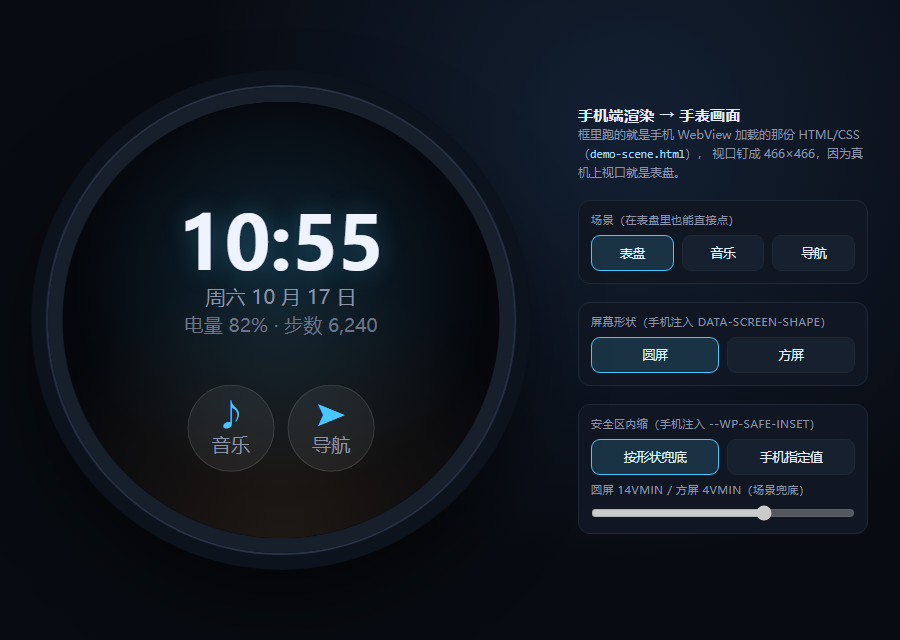
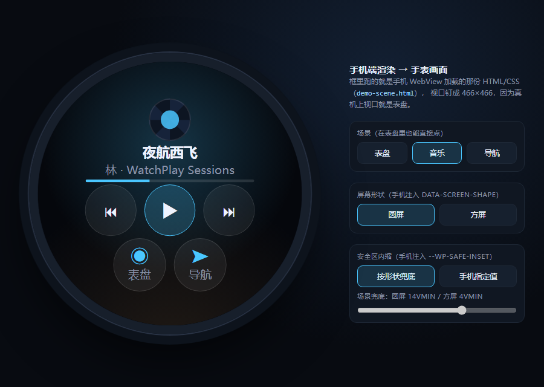
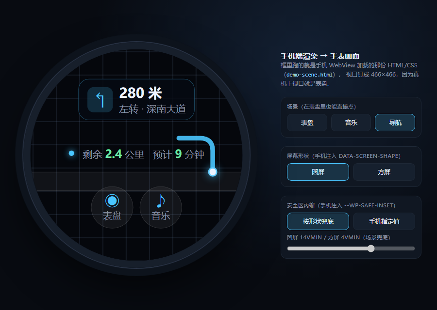
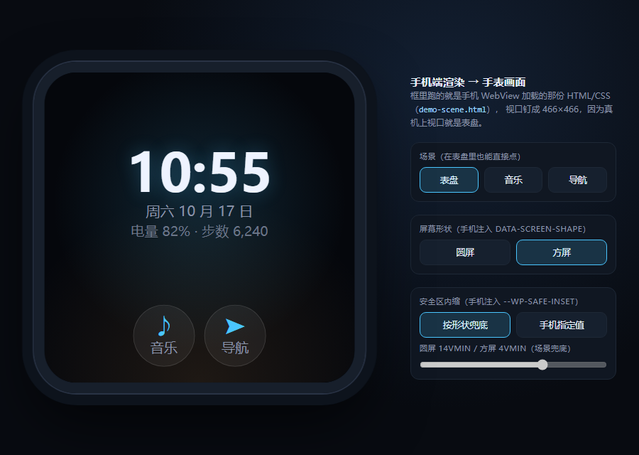

# 示例手表 UI

这里是符合 [协议渲染规范](../../docs/spec/06-rendering.md) 的场景样例。它们同时是**可运行的演示**和**规范的可执行说明**——每一份都刻意展示规范里的某几条约束。

## 怎么用

### 在浏览器里看

直接打开 `.html` 文件即可。这些场景是自包含的单文件，不请求任何外部资源（字体、图片、脚本全部内联），所以在浏览器里和在手表上的渲染结果一致。

### 在手机端 Demo 里看

`android/demo` 直接加载本目录的 [`demo-scene.html`](demo-scene.html)：`demo/build.gradle.kts` 把 `examples/watch-ui/` 加成 asset 目录，所以 APK 里就是这一份文件，没有第二份拷贝。链路是 `WatchScene` → `:sdk` 的 `WebViewRenderModule` → WebView → 捕获编码。用法见 [快速开始](../../docs/guides/getting-started.md)。

### 在真实手表上看

手表端不了解 HTML，它只收到编码后的像素。要让手表显示某个场景，需要：

1. 手机端 `UIRenderModule` 加载该 HTML
2. 捕获 → 编码 → 传输（见 [04-video.md](../../docs/spec/04-video.md)）

## 场景清单

| 文件 | 展示的规范要点 |
| :--- | :--- |
| [`demo-scene.html`](demo-scene.html) | 一个文档三个场景（表盘 / 音乐 / 导航），每页只给"另外两页"的入口，点击即切；安全区变量与圆屏/方屏形状兜底、方屏按钮放大、专辑封面（手机推来的 `data:` URI，取不到就退回 `conic-gradient` 黑胶纹）、内联 SVG 路线、零外部资源 |
| [`music-player.html`](music-player.html) | 安全区变量注入、`conic-gradient` 弧形进度条、圆屏/方屏自适应、触摸目标尺寸、纯状态更新不做动画 |

切换页面的逻辑在场景里，不在协议里：点按由场景自己处理，没有网络回环。手机要主动切页时走 `SceneUpdate.javascript = "window.watchplay.go('map')"`（`MirrorApp.Host.postUpdate`）。

手机推来的状态走另一个入口：`SceneUpdate.data` 里的键值先落进 `window.watchplay.data`，再执行 `window.watchplay.render()`，场景只负责把值写进 DOM（时间、电量、转向、距离都是这样来的）。场景自己算时间只是为了让浏览器预览看起来是活的，第一次收到数据后就停手——捕获可能发生在任意时刻，帧的内容必须由手机给出的状态唯一决定（`06-rendering.md` §3.7）。

## 浏览器预览（带圆形手表外壳）

[`preview/index.html`](preview/index.html) 把 `demo-scene.html` 装进一个 466×466 的 iframe，外面套圆形开孔，旁边有「场景 / 圆屏方屏 / 安全区」三组开关。用 iframe 是为了让 `vmin` 有个 466×466 的视口可算——真机上视口就是表盘。

| 预览 | 说明 |
| :--- | :--- |
|  | 圆屏、场景自己的 14vmin 兜底 |
|  | 同一个文档切换场景，不动布局参数 |
|  | 内联 SVG 路线 + CSS 网格，零外部请求 |
|  | 同一个文档：`data-screen-shape="square"` 让按钮放大、内缩换成 4vmin |

预览外壳只是模拟手机：它把 `?shape=` / `?inset=` 交给场景，让场景按开关表现。「按形状兜底」这一档不传内缩，场景用自己的 14vmin / 4vmin；「手机指定值」这一档把值写成内联声明，和真机上 `WebViewRenderModule` 的做法一致。

截图由无头浏览器生成，重新生成：

```pwsh
msedge --headless=new --disable-gpu --window-size=900,640 --virtual-time-budget=4000 `
  --screenshot=examples/watch-ui/preview/screenshot-face.png `
  "file:///<repo>/examples/watch-ui/preview/index.html?scene=face"
```

`preview/index.html` 接受 `?scene=face|music|map`、`?shape=round|square`、`?inset=<permille>`，方便直接截图或分享某一帧。

## 写自己的场景

### 必须遵守的约束

这些不是风格建议，而是**规范要求**（见 [06-rendering.md](../../docs/spec/06-rendering.md)）。

| 约束 | 为什么 |
| :--- | :--- |
| **必须**设置显式背景色 | JPEG 没有 alpha 通道，未定义背景会渲染成黑色 |
| **禁止**使用绝对像素做边距 | 同一份 HTML 要适配不同分辨率的手表 |
| **禁止**滚动 | WebView 捕获的是视口，滚动会让触控坐标映射出错 |
| **禁止**外部资源（字体/图片/脚本） | 一次网络请求落在捕获帧中间 = 一帧可见的卡顿；手表的 WebView 也未必有网 |
| **禁止**重度动画 | Profile A 下捕获约 10 fps，比这快的动画看不见，还会挤占编码预算 |
| **应当**用 `vmin` 做尺寸单位 | 圆屏的安全区是正方形，两个轴必须按短边等量内缩 |

### 起点模板

```html
<!DOCTYPE html>
<html lang="zh-CN" data-screen-shape="round">
<head>
<meta charset="utf-8">
<meta name="viewport" content="width=device-width, initial-scale=1, maximum-scale=1, user-scalable=no">
<style>
  :root { --wp-safe-inset: 14vmin; --bg: #0b0d12; --fg: #f2f4f8; }

  /* 形状兜底：只服务于浏览器预览。手机端会覆盖 <html> 上的 data-screen-shape，并把上报值写成
     <html> 的内联声明——内联压过这两条规则（§2.3 R1、§3.4）。 */
  html[data-screen-shape="round"]  { --wp-safe-inset: 14vmin; }
  html[data-screen-shape="square"] { --wp-safe-inset: 4vmin; }

  * { margin: 0; padding: 0; box-sizing: border-box; -webkit-tap-highlight-color: transparent; }
  html, body {
    width: 100%; height: 100%; overflow: hidden;
    background: var(--bg);            /* 必须：JPEG 无 alpha */
    color: var(--fg);
    font-family: system-ui, "Noto Sans CJK SC", sans-serif;
    -webkit-user-select: none; user-select: none; touch-action: none;
  }
  .safe {
    position: absolute; inset: 0;
    /* vmin 而非 %：圆屏安全区是正方形，两轴必须等量内缩 */
    padding: var(--wp-safe-inset);
    display: flex; flex-direction: column;
    align-items: center; justify-content: center; gap: 3vmin;
  }
</style>
</head>
<body>
  <div class="safe">
    <h1 style="font-size:8vmin">Hello Watch</h1>
  </div>
</body>
</html>
```

`<html>` 上的 `data-screen-shape="round"` 是**浏览器预览的默认值**：手机端按 `CAPS` 协商结果覆盖它，而不是"属性已存在就跳过"。同理，`--wp-safe-inset` 由手机写成 `<html>` 上的**内联**声明——内联压过任何样式表规则，所以上面两条形状兜底在真机上不可能赢过手表上报的值。

这条约束不是风格问题：`html[data-screen-shape="square"]` 的特异性是 `0,1,1`，高于 `:root` 的 `0,1,0`。如果手机把注入值塞进 `:root{}`（早期参考实现就是这么做的），方屏上会输给场景的 4vmin，等于手机自己编了边距——`06-rendering.md` §2.3 R2 与 §8 检查表都禁止这件事。

### 手机怎么把协商结果传进页面

手机端 `UIRenderModule` **必须**在 **document-start** 阶段把 `CAPS_ACK` 协商出的参数注入为 CSS 变量——不能等加载完成后再注入，否则首帧会带错误的安全区（表现为首帧内容贴边，第二帧才跳到位）。场景不应当自己猜测这些值。

```kotlin
// com.watchplay.sdk.render
val insetVmin = caps.safeInsetPermille / 10.0                       // 140 -> 14.0
val shape = if (caps.screenShape == SHAPE_ROUND) "round" else "square"
val js = """
    document.documentElement.dataset.screenShape = '$shape';
    document.documentElement.style.setProperty('--wp-safe-inset', '${insetVmin}vmin');
""".trimIndent()
WebViewCompat.addDocumentStartJavaScript(webView, js, setOf("*"))
```

其中：

- `shape` 来自 `DISPLAY.shape`（`1` = 圆形 → `"round"`，其余 → `"square"`）
- `insetVmin` = `DISPLAY.safe_inset_permille / 10.0`（圆屏 140‰ → `14.0vmin`）
- 完整注入代码与兜底路径见 [06-rendering.md §3.2](../../docs/spec/06-rendering.md)

### 用浏览器调试

场景里可以加一点只在开发时用的辅助代码，用来可视化安全区：

```html
<style>
  html[data-debug="1"] .safe { outline: 1px dashed rgba(255,0,0,.5); }
  html[data-debug="1"] body::after {
    content: ""; position: absolute; inset: 0; border-radius: 50%;
    box-shadow: inset 0 0 0 2px rgba(255,255,0,.4); pointer-events: none;
  }
</style>
```

在浏览器控制台里执行 `document.documentElement.dataset.debug = '1'` 打开。**发布前删掉**，或者不删也无妨——手表上没人会设这个属性。

### 圆屏的检查方法

把浏览器窗口调成正方形（例如 466×466），然后：

1. 打开 `data-debug`，确认黄色圆圈代表屏幕边缘。
2. 检查所有文字是否在**内接正方形**之内（红色虚线框）。
3. 检查有没有元素贴在圆圈附近——近边缘的触控目标容易误触，且视觉上会被切掉。

内接正方形的硬极限是每边内缩 `(1 − 1/√2)/2 ≈ 14.64%`；超过这个值就一定有内容落在圆外。圆屏默认上报 `140‰`（14%），留了约 0.6% 的安全裕度。
