# 手表端参考实现说明

本目录是 WatchPlay 协议在 **一块具体硬件（ESP32-S3 + LilyGO T-Display S3 AMOLED）** 上的参考实现。它的目的是证明协议可行并给厂商一个可抄的骨架，**不是一个产品固件**，也**不是协议要求**——下文出现的双核分工、PSRAM 双缓冲、TE 同步都是这块板的做法，换平台时按 [01-transport.md](../../docs/spec/01-transport.md) 与 [04-video.md](../../docs/spec/04-video.md) 的规范重新映射即可。

> ⚠️ 本目录的固件代码尚在开发中（M1 阶段）。当前文档描述的是**已定的架构与协议映射**；代码落地进度见 [路线图](../../README.md#路线图)。

## 参考硬件

| 项目 | 规格 |
| :--- | :--- |
| 开发板 | LilyGO T-Display S3 AMOLED 1.43 |
| 主控 | ESP32-S3R8，双核 Xtensa LX7 @ 240 MHz |
| 内存 | 512 KB 内部 SRAM + **8 MB 外部 PSRAM（Octal SPI）** |
| 显示 | 466×466 AMOLED 圆屏（1.43"），QSPI 接口，带 TE 信号 |
| 触摸 | FT3168 电容触摸，I²C |
| 无线 | **仅 BLE 5.0**。ESP32-S3 **没有经典蓝牙**，不支持 A2DP |

## 为什么选 MJPEG 而不是 H.264

ESP32-S3 **没有 H.264 硬件解码器**。

| | MJPEG（Profile A） | H.264（Profile B） |
| :--- | :--- | :--- |
| 解码方式 | **ROM 内建 JPEG 硬解**（`esp_jpeg_decode`） | `esp_h264` **软件**解码 |
| 466×466 实测量级 | 约 2–6 ms/帧 | 约 80–150 ms/帧（软解） |
| 可达到帧率 | 10–15 fps | 约 6–8 fps，且吃满一个核 |
| 功耗 | 低（硬件块） | 高（CPU 满载） |

因此 `CAPS.CODEC_H264` 中上报 **`hardware_decode = 0`** 与保守的 `max_fps = 8`。手机端的 `Negotiator` 有一条明确规则（[03-session.md §4.2](../../docs/spec/03-session.md)）：**只有 `hardware_decode == 1` 才选 H.264**。所以这块板子会自动协商到 MJPEG——这是设计好的路径，不是降级。

## 双核分工

这是本参考实现最重要的架构约束。任何把解码和蓝牙放在同一个核上的实现都会掉帧。



Credit 归还由 Core 1 在解码完成后通知 Core 0。

### 绑定方式

```c
// Core 1：解码 + 刷屏
xTaskCreatePinnedToCore(decode_task, "wp_decode", 4096, NULL, 10, NULL, 1);

// Core 0：BLE + 协议
xTaskCreatePinnedToCore(ble_task,    "wp_ble",    4096, NULL, 12, NULL, 0);
```

优先级说明：BLE 任务优先级（12）高于解码（10）。因为 BLE 协议栈有硬实的时序要求（连接事件必须在窗口内响应），错过会导致丢包甚至断连；解码晚几毫秒只是掉一帧。

### 跨核通信

**必须**使用固定大小的 FreeRTOS 队列，深度 **2**：

```c
QueueHandle_t s_frame_queue = xQueueCreate(2, sizeof(frame_ref_t));
```

- **禁止**用信号量 + 全局缓冲：容易漏帧，且在掉帧时极难调试。
- **禁止**深度 > 2：队列每深一格就多约 `1/fps` 的延迟，且不会自动恢复（latency creep）。
- 队列满时 **丢弃最旧的帧**，不要阻塞 BLE 回调——阻塞 BLE 回调会导致链路层缓冲溢出、进而断连。

## Credit 归还的时机（最容易写错的地方）

**必须在 Core 1 解码完成后归还 Credit，而不是在 Core 0 收到分块时归还。**

```
✗ 错误：Core 0 收到分块 → 立即 Credit++
   后果：手机持续满速推送，Core 1 跟不上时静默丢帧，
         手机端统计显示一切正常，但手表上画面卡顿。Credit 机制完全失效。

✓ 正确：Core 0 收到分块 → 入队
         Core 1 解码完成 → 通知 Core 0 → Credit++
   后果：手机端的发送速率被真实解码能力约束，自适应逻辑能正常收敛。
```

实现上用 `xQueueSend` 向一个"credit 归还队列"投递，由 Core 0 的 BLE 任务消费并生成 `FEEDBACK`。

## 内存布局

466×466 RGB565 每帧 434,312 字节 ≈ **424 KB**。

| 缓冲 | 大小 | 位置 | 说明 |
| :--- | :--- | :--- | :--- |
| 帧头层重组缓冲 | 520 B | 内部 RAM | `2 × (16 + max_chunk_bytes)`，见 [01-transport.md](../../docs/spec/01-transport.md) |
| 视频整帧重组缓冲 | ~2 MB | **PSRAM** | 按 `max_frame_bytes` 一次性分配 |
| 显示双缓冲 ×2 | **848 KB** | **PSRAM** | `2 × 466 × 466 × 2` |
| JPEG 解码工作区 | ~64 KB | PSRAM | 硬解需要行缓冲 |
| 跨核队列 | 极小 | 内部 RAM | 只放引用，不放像素 |

**关键约束：所有缓冲必须在会话建立时一次性分配。** 运行时的 `malloc`/`free` 在长时间运行下必然产生堆碎片；一个 10 fps、连跑数小时的投屏会话一定会撞上这个问题。收到 `CAPS_ACK` 后立即按协商值分配，会话结束后释放。

### `color_format` 与字节序

AMOLED 面板驱动（CO5300/SH8601）通过 QSPI 接收 **RGB565 大端**，而 PSRAM 中的解码输出是小端。参考实现上报 **`color_format = 2`（RGB565_BE）**，让手机侧在解码/转换阶段做字节交换，避免手表在每帧刷屏时对 217,156 个像素逐个 `__builtin_bswap16`。见 [03-session.md §3.3.1](../../docs/spec/03-session.md)。

## 防撕裂

AMOLED 面板有 TE（Tearing Effect）信号。刷屏 **必须**等 TE 再切缓冲：

```
解码完成 → 写入后缓冲 → 等 TE 下降沿 → 切换前后缓冲指针 → QSPI DMA 启动
```

- 不做 TE 同步：10 fps 下撕裂非常明显（画面上会有一条横向错位）。
- 单缓冲：必然撕裂，不可接受。
- TE 等待 **禁止**在持有队列锁时进行。

## 协议映射

| 协议概念 | 参考实现对应 |
| :--- | :--- |
| `HELLO` / `HELLO_ACK` | `wp_proto_handshake()`，发送 52 字节 `HELLO` |
| `CAPS` | `wp_caps_build()`，产出 TLV 列表：`DEVICE_INFO` + `DISPLAY` + `CODEC_MJPEG` + `INPUT` + `MEMORY` |
| `CAPS_ACK` | 解析 `RESULT` + `STREAM`，据此分配缓冲并配置解码器 |
| `VIDEO` 分块 | `wp_video_feed()`，重组到整帧缓冲 |
| `FEEDBACK` | `wp_feedback_send()`，解码完成后调用 |
| `TOUCH` | `ft3168_poll()` → 内接圆判定 → `wp_touch_send()` |
| 圆屏越界 | `wp_point_in_circle()`，见 [05-input.md §2.2](../../docs/spec/05-input.md) |

### 上报的关键能力值

| 字段 | 值 | 理由 |
| :--- | :--- | :--- |
| `DISPLAY.width` / `height` | `466` / `466` | 物理面板 |
| `DISPLAY.shape` | `1`（圆形） | |
| `DISPLAY.color_format` | `2`（RGB565_BE） | 面板需要大端 |
| `DISPLAY.safe_inset_permille` | `140` | 14%，圆屏推荐值，硬极限 14.64% |
| `DISPLAY.tearing_mode` | `1` | 有 TE 引脚 |
| `CODEC_MJPEG.max_fps` | `12` | 硬解实测上限，留一点余量 |
| `CODEC_MJPEG.subsampling` | `2`（4:2:0） | 硬解最省 |
| `CODEC_H264.hardware_decode` | `0` | **软解**，这是让 `Negotiator` 退回 MJPEG 的关键 |
| `CODEC_H264.max_fps` | `8` | 软解现实值 |
| `INPUT.touch_points` | `1` | FT3168 单点（参考实现只用单点） |
| `AUDIO.path` | `0` | **无音频能力**——ESP32-S3 无经典蓝牙，无法 A2DP |
| `MEMORY.psram_bytes` | `8388608` | 8 MB |

> `AUDIO.path = 0` 不是"暂未实现"，而是硬件事实。音频由手机本地播放，手表只显示界面与回传触控。见 [00-overview.md](../../docs/spec/00-overview.md)。

## 构建

```pwsh
# 需要 ESP-IDF v5.1+
idf.py set-target esp32s3
idf.py menuconfig      # 确认 PSRAM = Octal SPI，Flash = 16MB
idf.py build
idf.py -p COM<N> flash monitor
```

### 必须确认的 menuconfig 项

| 配置 | 值 | 不设的后果 |
| :--- | :--- | :--- |
| `CONFIG_SPIRAM` | `y`，模式 Octal | 双缓冲放不下，无法工作 |
| `CONFIG_SPIRAM_MODE_OCT` | `y` | PSRAM 带宽不足，刷屏撕裂 |
| `CONFIG_ESP_DEFAULT_CPU_FREQ_MHZ` | `240` | JPEG 解码时间翻倍 |
| `CONFIG_FREERTOS_HZ` | `1000` | 10 fps 的调度粒度不够 |
| `CONFIG_BT_BLE_42_FEATURES_SUPPORTED` | `y` | 部分手机连不上 |
| `CONFIG_BT_GATTS_ENABLE` | `y` | |

### PSRAM 配置的一个坑

`CONFIG_SPIRAM_USE_MALLOC` 会让 `malloc` 自动落到 PSRAM。**不要**在解码路径上依赖它——PSRAM 的访问延迟显著高于内部 RAM，在 Core 1 抢带宽时会直接影响 JPEG 解码时间。参考实现显式使用 `heap_caps_malloc(size, MALLOC_CAP_SPIRAM)` 只为大块缓冲申请 PSRAM，其余一律内部 RAM。

## 已知限制

| 限制 | 影响 | 缓解 |
| :--- | :--- | :--- |
| 无经典蓝牙 | 无法 A2DP | 音频手机本地播放 |
| H.264 只能软解 | Profile B 不可用 | `hardware_decode = 0` 让协商自动退回 MJPEG |
| 仅单点触控 | 复杂手势不可用 | v0.2 议题 |
| BLE 带宽上限 | 10 fps 已接近上限 | 更高的码率需要 Wi-Fi 承载（Phase 2） |
| CoC MTU 封顶 512 | 无法一次装下多个大帧 | 足够——一个 260 字节的协议帧轻松装入 |

## 贡献

手表端代码 **必须**遵守 [贡献指南](../../CONTRIBUTING.md) 的 C 规范，特别是：

- 所有跨核共享结构 **必须**在注释里写明由哪个核拥有、用什么原语同步
- 中断上下文 **禁止**调用非 `_from_isr` 后缀的 FreeRTOS API
- 动态分配 **必须**在会话建立时一次性完成
- 涉及协议的改动 **必须**先在 [07-capabilities.md](../../docs/spec/07-capabilities.md) 登记编号
